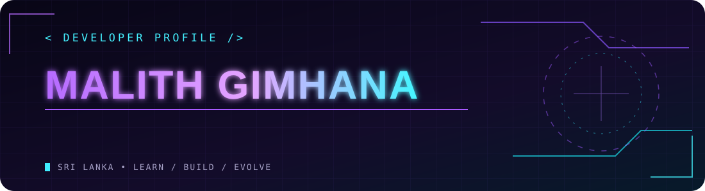

 

## 💜 About Me

I'm **Malith Gimhana**, a **Computer Science undergraduate at NSBM Green University, Sri Lanka**. I enjoy turning ideas into useful applications, learning how systems work, and growing through hands-on projects.

- 🎓 Studying **Computer Science** at **NSBM Green University**
- 💻 Interested in **software engineering, full-stack applications, and backend systems**
- 🛠️ Building with **Java, Spring Boot, JavaScript, PHP, Python, and SQL**
- 🚀 Exploring practical solutions for **healthcare, campus life, and workforce management**
- 🌱 Always learning, experimenting, and improving

## ⚡ Tech Stack & Tools

**Languages**

  

**Frameworks & Development**

  

**Databases, Tools & Platforms**

  

These logos represent technologies I have worked with or explored; experience levels vary.

##  🚀 Featured Projects

<table>
  <tr>
    <td width="50%" valign="top">
      <h3>🏥 SuwaSewana</h3>
      <b>Doctor & Patient Management System</b>
      

        Web-based healthcare management system
        for patients, doctors, appointments,
        and medical records.
      

      

        <code>HTML</code> <code>CSS</code>
        <code>JavaScript</code> <code>PHP</code>
        <code>MySQL</code>
      

      <a href="https://github.com/malithgimhana/SuwaSewana">
        View Repository
      </a>
    </td>
    <td width="50%" valign="top">
      <h3>⚡ FlexiWork</h3>
      <b>Shift & Workforce Management Platform</b>
      

        Workforce platform for shift postings,
        worker applications, attendance
        verification, and reporting.
      

      

        <code>Spring Boot</code> <code>REST API</code>
        <code>JWT</code> <code>MySQL</code>
      

      <i>Repository link not confirmed.</i>
    </td>
  </tr>
</table>

**Also explored:** Student Course Registration API, Hospital Patient Management API, AI-assisted e-channeling SRS, and software design coursework.

## 📈 GitHub Activity

<!-- Native GitHub activity remains available via the Contributions tab.
     External stats cards are intentionally omitted to avoid broken images / API limits. -->

<h2 align="center">🌐 Connect With Me</h2>

  
  
  
  
  
  

⚡ Learn. Build. Improve. Repeat. ⚡

